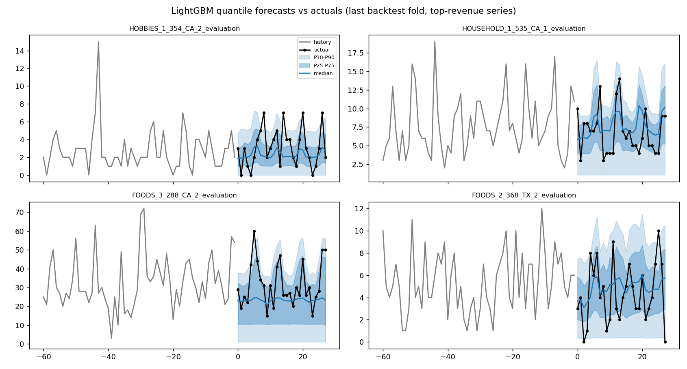
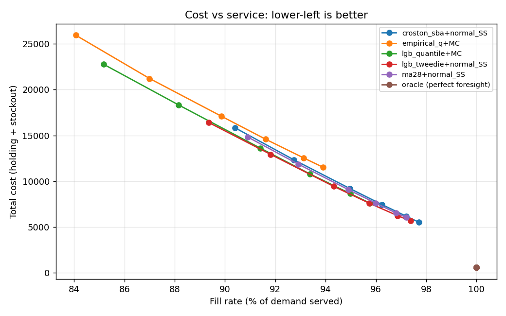
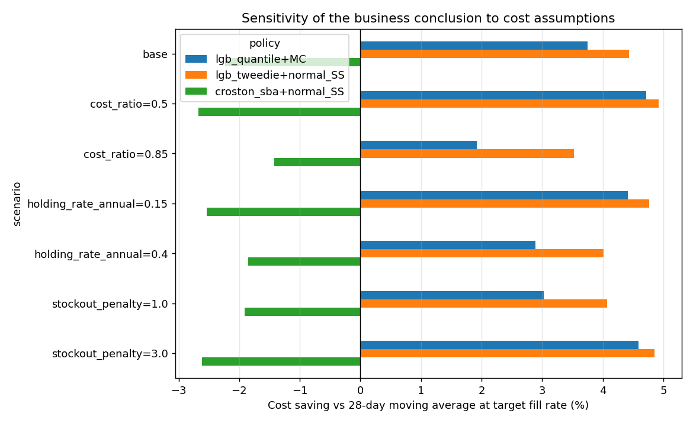
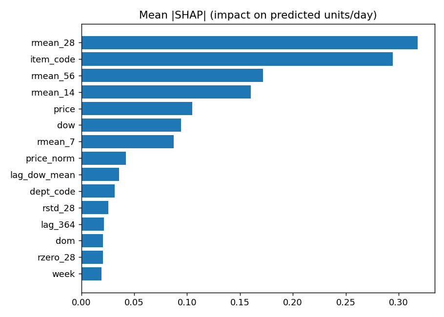

# Retail Demand Forecasting + Inventory Optimization (Walmart M5)

**Problem.** A retailer has to decide how much of each product to order. Order too little and it loses sales;
order too much and cash sits in inventory. This project forecasts 28-day demand for each product-store on
Walmart's M5 data, predicts full uncertainty ranges rather than single numbers, and converts those forecasts
into ordering decisions whose dollar cost is measured in a day-by-day simulation. Models are compared on
**cost at the same service level**, not only forecast error.



## Key results
Backtest on a random sample of **1,000 of the 30,490 M5 item-store series**, 3 rolling folds of 28 days
(last window: 2016-04-25 to 2016-05-22). About 58% of daily values are zero. Full tables: **[docs/RESULTS.md](docs/RESULTS.md)**.

| Model | WRMSSE (lower better) | Scaled pinball | P10-P90 coverage |
|---|---|---|---|
| **LightGBM (Tweedie)** | **0.810** | - | - |
| 28-day moving average | 0.822 | - | - |
| Croston-SBA | 0.830 | - | - |
| LightGBM quantile (median as point) | 0.857 | **0.359** | 85.4% |
| Empirical quantiles (own history) | 0.886 | 0.369 | 91.2% |
| Seasonal naive | 1.067 | - | - |
| Naive | 1.133 | - | - |

Simulated inventory cost at a **95% fill rate** (order every 7 days, 2-day lead time):

| Policy | Cost ($) | vs moving-average policy |
|---|---|---|
| LightGBM Tweedie + normal safety stock | 8,550 | **4.4% cheaper** |
| LightGBM quantiles + Monte-Carlo base stock | 8,612 | 3.7% cheaper |
| 28-day moving average + normal safety stock | 8,947 | baseline |
| Croston-SBA + normal safety stock | 9,147 | 2.2% more expensive |

- Both LightGBM policies stayed cheaper than the baseline in **all 7 cost scenarios** (+3.5% to +4.9% and +1.9% to +4.7%).
- The empirical-quantile policy could not reach 95% fill, so its cost is not comparable (flagged `in_range = False`).
  The perfect-foresight oracle is also out of range; it is an upper bound only.
- Top SHAP drivers: 28-day rolling mean, item identity, 56-day rolling mean, 14-day rolling mean, price.






## What worked, what didn't, and why
**Worked**
- LightGBM with a Tweedie loss was the most accurate point forecaster (WRMSSE 0.810 vs 0.822 for the moving average).
  Likely reason: it uses price, promo-style price changes and calendar effects that the baselines ignore.
- The quantile model gave sharper probabilistic forecasts than each series' own history (pinball 0.359 vs 0.369).
- The dollar result was larger than the accuracy gap suggests: a 1.4% error reduction became a 4.4% cost saving.
  Safety stock amplifies forecast error, so small accuracy gains matter more for cost than for the error metric.
- The saving held under every cost assumption I tested, so it does not hinge on my made-up cost numbers.

**Didn't work**
- Naive and seasonal naive were poor (1.13 and 1.07): with ~58% zero days, a single past day is a noisy predictor.
- Croston did not beat a plain 28-day average.
- The richer quantile + Monte-Carlo policy did **not** beat the simpler Tweedie + normal safety-stock policy.
  Possible causes (not tested): the independence-between-days assumption, linear extrapolation beyond P90,
  and intervals that over-cover (85% vs 80% target), which makes the sampled demand too cautious in places.
- Conformal calibration changed nothing (correction = 0). The intervals already over-cover, and with
  zero-heavy demand most conformity scores are exactly 0, so it can only widen bands that under-cover.
- The quantile model's median is a weak point forecast (0.857) because the median of zero-inflated demand is often 0.

**Caveats**
- 1,000-series sample, 3 folds and no confidence intervals: the differences between top models are modest and
  fold-to-fold WRMSSE ranges overlap. Treat the ranking as indicative, not proven.
- Costs are assumed (70% cost ratio, 25%/yr holding, 1.5x margin stock-out penalty).
- WRMSSE is item-store level only, so it is **not comparable** to the official M5 leaderboard.

## Pipeline
| Step | File | Notes |
|---|---|---|
| Data as dense arrays | `src/data.py` | M5 loader + synthetic M5-like generator |
| Leak-free features | `src/features.py` | lags >= 28, rolling stats, price/promo, calendar, SNAP; direct 28-day forecasting |
| Baselines | `src/baselines.py` | naive, seasonal naive, 28-day MA, Croston-SBA, empirical quantiles |
| ML models | `src/lgb_models.py` | LightGBM Tweedie (mean) + quantile models (P10-P90); TreeSHAP |
| Calibration | `src/conformal.py` | conformalized quantile regression on the P10-P90 band |
| Metrics | `src/metrics.py` | WRMSSE (item-store level), scaled pinball loss, interval coverage |
| Inventory | `src/inventory.py` | order-up-to policy, Monte-Carlo base stock from quantiles, vectorised simulator |
| Orchestration | `src/run.py` | rolling-origin backtest (3 x 28 days), cost-assumption sensitivity |
| Reporting | `src/summarize.py` | builds `docs/RESULTS.md` and copies charts |
| Demo | `app/streamlit_app.py` | pick a product, see forecast band and recommended order |
| Self-checks | `checks.py` | leakage test, simulator sanity tests, validation of `results/` |

Design rationale for every choice: **[docs/INTERVIEW_GUIDE.md](docs/INTERVIEW_GUIDE.md)**.

## Run it
All commands below are run from the project folder (the one containing `config.yaml`).

### 1. Install
```powershell
pip install -r requirements.txt -r requirements-app.txt
```

### 2. Run the pipeline
```powershell
python -m src.run --synthetic      # smoke test, ~4 min, no download needed
python -m src.summarize            # writes docs/RESULTS.md and copies the charts into docs/
```
Real data: download the M5 files from Kaggle (m5-forecasting-accuracy) into `data/raw/`
(`sales_train_evaluation.csv`, `calendar.csv`, `sell_prices.csv`), then run `python -m src.run`.
Edit `config.yaml` to change `data.n_series`, folds, costs or service levels.

**Google Colab:** open `notebooks/colab_run.ipynb`. It runs the pipeline and lets you download a `results` +
`docs` zip. Note that the Streamlit tunnel in Colab is unreliable; the app runs more smoothly locally (below).

### 3. Run the Streamlit app on Windows (PowerShell)
The app reads `results/app_data.npz`, which is created by `python -m src.run`. If you ran the pipeline in Colab,
unzip the downloaded `outputs.zip` and put its `results` folder inside the project folder first.

1. Open the project folder in File Explorer, click the address bar, type `powershell` and press Enter
   (or open PowerShell and `cd` to the folder, e.g. `cd C:\Users\<you>\Desktop\m5_forecasting`).
2. Install the requirements (first time only):
   ```powershell
   pip install -r requirements.txt -r requirements-app.txt
   ```
3. Start the app:
   ```powershell
   streamlit run app/streamlit_app.py
   ```
4. Your browser opens at `http://localhost:8501`. If it does not, open that address yourself.
5. Choose a product-store in the sidebar, move the service-level slider, enter units on hand, and tick
   "Show actual demand (backtest)" to compare the forecast band with what really sold.
6. Stop the app with `Ctrl + C` in PowerShell.

Troubleshooting:
- `'streamlit' is not recognized`: use `python -m streamlit run app/streamlit_app.py` instead.
- `'python' is not recognized`: try `py` in place of `python`, or install Python and tick "Add to PATH".
- The page says `results/app_data.npz not found`: run the pipeline first, or copy the `results` folder in.
- Optional isolated environment:
  ```powershell
  python -m venv .venv
  .\.venv\Scripts\Activate.ps1      # if blocked: Set-ExecutionPolicy -Scope Process Bypass
  pip install -r requirements.txt -r requirements-app.txt
  ```

### 4. Verify the project with `checks.py`
`checks.py` is a self-test. It takes a few seconds and prints `[PASS]` or `[FAIL]` for each check.
```powershell
python checks.py             # code checks only, no data needed
python checks.py --results   # also validates the results/ folder from a real run
```
What it checks:
- **No future leakage:** all sales after a forecast cutoff are scrambled, and the features for training and forecast rows must not change.
- **Inventory simulator:** unlimited stock gives a 100% fill rate, zero stock gives 0%, and sold + lost = demand.
- **Quantile and conformal logic:** no crossing quantiles or negative values; a higher service level never lowers the order-up-to level.
- **Real results (`--results`):** naive is worse than the moving average, interval coverage is plausible, saved forecasts are sorted, fill rates stay within 0-1 and rise with service level, and the perfect-foresight oracle reaches about 100%.

A healthy run ends with `ALL CHECKS PASSED`. If a line says `[FAIL]`, that part of the pipeline needs investigating
before trusting the results. These checks show the code is consistent and leak-free; they do not prove the numbers
match the official M5 leaderboard.

## Assumptions and limitations
- Costs are assumed (70% cost ratio, 25%/yr holding, 1.5x margin stock-out penalty); sensitivity is one-at-a-time.
- WRMSSE is computed at item-store level only; no hierarchical reconciliation.
- Hyperparameters are untuned; 3 backtest folds; subsample of series.
- Monte-Carlo policy assumes independent days and extrapolates the tail above P90.
- Conformal coverage is approximate because time series are not exchangeable.

## Next steps
Hierarchical reconciliation (MinT), Optuna tuning, N-BEATS/TFT, bootstrap confidence intervals on savings,
all 30,490 series.
